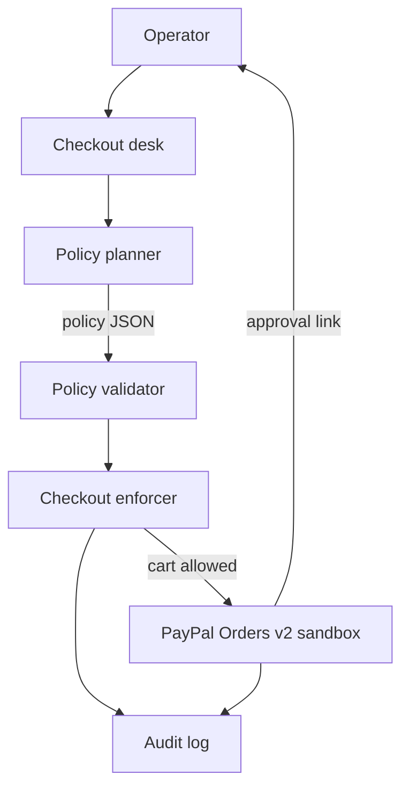

# Agent Checkout Steward

An operator asks an agent to buy something. The agent drafts a purchase policy. Application code accepts that policy only when it stays inside a hard mandate, then PayPal sandbox takes the payment. A model cannot raise the cap, add a merchant, switch the purchase to a subscription, or waive a second approval.

This is a PayPal AI Hackathon 2026 project. It moves sandbox money only. It is not a PayPal product and there is no partnership.

## Problem

An agent that can check out needs a budget, a merchant list, and a stop when the cart changes. Those limits have to live in code. A prompt can suggest them. It cannot be the thing that enforces them.

The mandate in this demo is fixed:

- Budget cap **USD 150.00**
- Merchants **Harbor & Co** and **Northline Supply**
- **One-time** purchases
- A new approval if the **amount** or the **merchant** changes

## How PayPal is used

PayPal is the payment rail. The client speaks Orders v2 on `https://api-m.sandbox.paypal.com`:

1. `POST /v1/oauth2/token` with `grant_type=client_credentials` and HTTP Basic auth (`PAYPAL_CLIENT_ID:PAYPAL_CLIENT_SECRET`).
2. `POST /v2/checkout/orders` with `intent: "CAPTURE"`, a USD amount with two decimals, `custom_id` (a policy hash, not a person), `invoice_id`, and `payment_source.paypal.experience_context` (`PAY_NOW`, `LOGIN`, `NO_SHIPPING`, return and cancel URLs). The call sends `PayPal-Request-Id` and `Prefer: return=representation`. HTTP 200 and 201 are both success.
3. The buyer opens the HATEOAS approval link (`payer-action`, otherwise `approve`). For this sandbox that is `https://www.sandbox.paypal.com/checkoutnow?token=ORDER_ID`. If PayPal omits the link, the client uses that same checkout URL.
4. `GET /v2/checkout/orders/{id}` until the status is `APPROVED`.
5. `POST /v2/checkout/orders/{id}/capture`.

Live hosts (`api-m.paypal.com`, `api.paypal.com`) are rejected before a request is sent. Transient HTTP 429 and 5xx responses are retried up to three times with the same `PayPal-Request-Id`. The declined-payment scenario sends PayPal's sandbox negative-test header `PayPal-Mock-Response: {"mock_application_codes":"INSTRUMENT_DECLINED"}` on capture.

`custom_id` is a hash of the confirmed policy and cart. The audit log stores the PayPal order id next to that policy snapshot. Card numbers, access tokens, and payer ids are not written.

## How AI is used

The planner asks the configured model for two things:

1. **Policy JSON**: budget cap, merchant allowlist, `purchaseKind: "one_time"`, both re-approval flags, and a one-sentence summary.
2. **Status narration**: one or two sentences that explain the outcome the code already chose.

`validateProposal` accepts the JSON only when it fits the mandate. A draft that fails validation is discarded and the deterministic fallback drafts a valid policy. A narration that contradicts the outcome (for example, calling a refusal a completed capture) is discarded. The audit log keeps the coded sentence. The desk badge shows which planner and model are active, such as `AI Gateway (google/gemini-2.5-flash)` or `Deterministic fallback (no model call)`.

With no model key, `LLM_PROVIDER=auto` uses the deterministic fallback, so the desk and the demo run without an AI account.

| `LLM_PROVIDER` | Behavior |
| --- | --- |
| `auto` | AI Gateway if `AI_GATEWAY_API_KEY` is set, otherwise OpenAI-compatible if `OPENAI_BASE_URL` is set, otherwise Anthropic if `ANTHROPIC_API_KEY` is set, otherwise the fallback |
| `gateway` | Vercel AI Gateway through the AI SDK (`generateText` + `gateway(model)`). Requires `AI_GATEWAY_API_KEY`. Model is `AI_GATEWAY_MODEL` (default `google/gemini-2.5-flash`) |
| `openai` | `POST {OPENAI_BASE_URL}/chat/completions` (Ollama and any OpenAI-compatible host) |
| `anthropic` | Anthropic Messages API |
| `none` | Deterministic fallback |

The gateway reads `AI_GATEWAY_API_KEY` from the environment. Model ids are `provider/model` values from https://ai-gateway.vercel.sh/v1/models.

## Architecture



Mock mode uses the same session and the same enforcer. The mock client never opens a socket to PayPal.

## Honesty

- No API keys, client ids, or secrets belong in this repo, in screenshots, or in the audit log.
- Sandbox credentials stay in `.env`, which is gitignored.
- The payment rail is PayPal sandbox. There is no production traffic and no claim of a PayPal partnership.
- XRPL is not used.

## Mock mode

Node.js 22.

```bash
npm ci
npm test
npm run typecheck
npm run demo
npm run demo:errors
npm run serve
```

Open http://127.0.0.1:4320 . `npm run demo` forces mock mode so a shell that already has sandbox credentials does not create an order. The desk follows `CHECKOUT_MODE`.

`auto` (the default) uses the sandbox when both `PAYPAL_CLIENT_ID` and `PAYPAL_CLIENT_SECRET` are non-empty, and mock otherwise.

The desk purchases:

| Purchase | What the code does |
| --- | --- |
| Sensor, within cap | Harbor & Co, USD 86.00. Draft, confirm, create, approve, capture. |
| Over the budget cap | USD 240.00. Create is refused. PayPal is not called. |
| Merchant not allowed | Night Market LLC. Create is refused. |
| Amount changes | Confirm USD 86.00, apply the USD 110.00 revision, approve again, then create. |
| Buyer cancels | Cancel after create. Capture is not requested. |
| Payment declined | Capture returns a declined instrument. |

In mock mode the approval page is local and labeled simulated.

## Sandbox mode

Create a sandbox REST app at https://developer.paypal.com/dashboard/applications/sandbox . Copy `.env.example` to `.env` and set:

```bash
PAYPAL_CLIENT_ID=...
PAYPAL_CLIENT_SECRET=...
PAYPAL_API_BASE=https://api-m.sandbox.paypal.com
```

Leave the values out of git. Then:

```bash
npm run serve
```

The badge reads **PayPal sandbox**. Run the sensor purchase:

1. Draft the policy and confirm it.
2. Press **Create PayPal order**.
3. Press **Open PayPal approval** (or copy the approval link). A sandbox checkout tab opens.
4. Sign in as the **US Personal** test buyer. The email and system-generated password are under PayPal Developer Dashboard → Testing Tools → Sandbox Accounts. This is not a live PayPal login.
5. Approve the payment. PayPal redirects the browser to `/paypal/return?token=ORDER_ID&PayerID=...` on this desk. The desk ignores `PayerID`. It also checks the order every few seconds while it is waiting.
6. When the status is `APPROVED`, press **Capture payment**.

That desk path is the one to record: create the order on the desk, approve as the US Personal buyer, land on the return page, then capture. If the order was created by `npm run demo:sandbox` instead, the return page still looks the order up with `GET /v2/checkout/orders/{id}`. When `data/audit.jsonl` has the policy snapshot, the desk adopts that snapshot and offers capture. When the snapshot is missing, it still shows the PayPal status and offers capture once the order is `APPROVED`.

The same create-and-print-the-link path from a terminal:

```bash
npm run demo:sandbox
npm run capture -- ORDER_ID
```

`demo:sandbox` confirms the USD 86.00 sensor policy, creates one sandbox order, and stops before capture. `npm run capture -- ORDER_ID` loads that order, refuses to capture until PayPal reports `APPROVED`, then captures.

For the declined scenario, capture sends PayPal's negative-test header. Cancel uses the desk button or PayPal's cancel redirect. Orders v2 has no separate merchant cancel call; an uncaptured order is left to expire, and capture is not requested.

If create-order rejects the return URL, set `CHECKOUT_PUBLIC_BASE` to an https origin that reaches this desk. Approval still works from the link when the return URL is only a browser redirect.

## Audit log

The desk appends JSON lines to `data/audit.jsonl` (gitignored). Each checkout line has the event, the PayPal order id when one exists, `custom_id`, and the policy snapshot (cap, allowlist, one-time, re-approval flags, cart merchant, cart amount). Reset clears the on-screen list and appends a reset line. The file is not a place for tokens or payer data; the writer drops those fields.

## Tests

```bash
npm test
npm run typecheck
```

`npm test` covers the mandate validator, the enforcer (over cap, off-list merchant, amount change, merchant change, subscription), the deterministic, Anthropic, and AI Gateway planners (the gateway call is injected, not sent to Vercel), narration that is not allowed to overturn a refusal, the Orders v2 request shape, the mock session, PayPal return adoption, and the desk HTTP API. Nothing in the test suite calls `api-m.sandbox.paypal.com` or the AI Gateway.

## Live sandbox

The CLI path has been run against the sandbox: `demo:sandbox` created order `5V428860R6140020E` (`PAYER_ACTION_REQUIRED`), the US Personal test buyer approved it, and `npm run capture` returned capture `2JR76938T1840114E` `COMPLETED`.

The desk return handler now adopts an order that was created outside the open session. The recording path is still create on the desk, approve, return, then capture. If PayPal rejects the `http://127.0.0.1:4320/paypal/return` URL on create, set `CHECKOUT_PUBLIC_BASE` to an https origin that reaches the desk. Approval from the HATEOAS link works either way.
